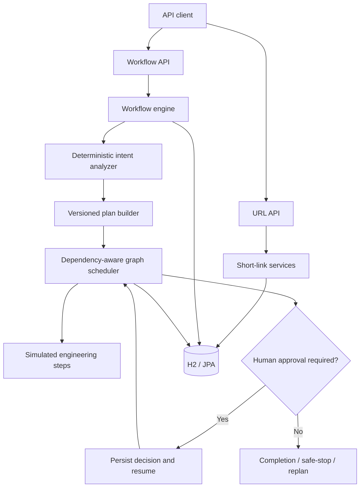

# Governed Workflow Orchestrator & URL Shortener

**A Java 17 / Spring Boot reference implementation for stateful, policy-governed engineering workflows.**

This project combines a working URL-shortening API with a deterministic workflow engine that models how a software change moves from requirement analysis through design, implementation proposal, verification, human approval, and delivery readiness. The emphasis is on **execution state, dependency ordering, auditability, and controlled recovery**, rather than autonomous code generation.

> **Project status:** Engineering prototype. The URL shortener is functional; the orchestration engine executes deterministic, simulated engineering steps. It does **not** modify source code, run real build/security tools against a generated patch, deploy changes, or invoke an LLM. See [Limitations](#limitations-and-production-considerations).

## What this demonstrates

| Capability | Implementation |
| --- | --- |
| URL shortening | Create short links, optional custom aliases and expiration, HTTP redirects, click analytics |
| Dependency-aware workflows | Versioned execution graphs; independent runnable steps can execute concurrently |
| Human-in-the-loop governance | Risk-dependent approval gates before or after selected steps |
| Durable execution evidence | Persisted workflow, step, approval, and event records |
| Failure handling | Bounded retries, deterministic fallback, controlled replanning, logical compensation, and safe-stop |
| Audit and observability | Workflow events, step history, approval records, reliability metrics, Actuator endpoints |
| API discoverability | OpenAPI specification and interactive Swagger UI |
| Automated verification | JUnit / Spring Boot integration tests and architecture conventions |

## Architecture

The application is a **modular monolith** with two bounded areas: `url` and `agent` (workflow orchestration). Spring Data JPA persists both domains in a local file-backed H2 database.



Each workflow plan contains a dependency graph covering impact analysis, API design, optional data design, implementation proposal, test design, build verification, security and policy validation, documentation, and delivery readiness. Approval gates depend on the risk classification of the requested change.

Successful step outputs are persisted and rehydrated when an approval resumes a workflow. Replanning creates a new plan version and retains superseded execution history for inspection.

**Key source areas**

- `src/main/java/com/example/agenticurl/url/` — URL API, services, DTOs, entity, repository.
- `src/main/java/com/example/agenticurl/agent/` — workflow API, planning, scheduling, policies, persistence, audit views.
- `src/test/` — controller, workflow, OpenAPI, policy, and architecture tests.
- `docs/` — architecture, scenarios, verification approach, trade-offs, and limitations.

For more detail, see [Architecture Overview](docs/architecture.md).

## Technology

- **Runtime:** Java 17, Spring Boot 3.3.2
- **API:** Spring Web, Jakarta Validation, Springdoc OpenAPI / Swagger UI
- **Persistence:** Spring Data JPA, Hibernate, file-backed H2
- **Concurrency:** `CompletableFuture` for local parallel execution
- **Testing:** JUnit 5, Spring Boot Test
- **Build:** Gradle (wrapper included)
- **Observability:** Spring Boot Actuator, persisted execution events and metrics

## Run locally

**Prerequisites:** JDK 17 installed. The repository includes the Gradle wrapper, so a separate Gradle installation is not required.

```bash
# Clone and enter the repository
git clone https://github.com/mohan270/url-shortener-orchestrator.git
cd url-shortener-orchestrator

# Run automated tests
./gradlew clean test

# Start the application
./gradlew bootRun
```

On Windows, use `gradlew.bat` instead of `./gradlew`.

The application starts at **http://localhost:8080**. The local H2 database is stored under `./data/` and is excluded from version control.

| Endpoint | Purpose |
| --- | --- |
| `http://localhost:8080/swagger-ui/index.html` | Explore and invoke documented APIs |
| `http://localhost:8080/v3/api-docs` | Retrieve OpenAPI JSON |
| `http://localhost:8080/actuator/health` | Application health |

## Try the URL-shortening API

### Create a short URL

```bash
curl -X POST http://localhost:8080/api/urls \
  -H 'Content-Type: application/json' \
  -d '{
    "url": "https://example.com/docs",
    "customAlias": "example-docs",
    "expiresInDays": 7
  }'
```

The API returns `201 Created` with the short code, short URL, and expiration timestamp.

### Resolve and inspect analytics

```bash
# Returns HTTP 302 with a Location header
curl -i http://localhost:8080/example-docs

# Returns click count and lifecycle timestamps
curl http://localhost:8080/api/urls/example-docs/analytics
```

An unknown code returns `404`, and an expired URL returns `410`. A conflicting custom alias is reported as `409` by the API. Concurrency improvements for alias allocation and click counts remain on the roadmap.

## Try a governed workflow

### 1. Start a change request

```bash
curl -X POST http://localhost:8080/api/workflows \
  -H 'Content-Type: application/json' \
  -d '{"requirement": "Add expiration support to short URLs"}'
```

The response includes the workflow ID and current state. Depending on its policy, execution may pause for human review.

### 2. Inspect persisted state and evidence

Replace `<workflow-id>` with the ID returned above:

```bash
curl http://localhost:8080/api/workflows/<workflow-id>
curl http://localhost:8080/api/workflows/<workflow-id>/steps
curl http://localhost:8080/api/workflows/<workflow-id>/events
curl http://localhost:8080/api/workflows/<workflow-id>/approvals
curl http://localhost:8080/api/workflows/<workflow-id>/metrics
```

### 3. Approve a waiting step

Find a step with status `WAITING_REVIEW` in the step results, then submit its `stepId`:

```bash
curl -X POST \
  http://localhost:8080/api/workflows/<workflow-id>/steps/<step-id>/review \
  -H 'Content-Type: application/json' \
  -d '{"decision": "APPROVED", "comment": "Reviewed and approved"}'
```

To reject instead, use `"decision": "REJECTED"`. Approvals are stored by workflow, plan version, step, and review phase.

### 4. Replan after a requirement change

```bash
curl -X POST http://localhost:8080/api/workflows/<workflow-id>/replan \
  -H 'Content-Type: application/json' \
  -d '{"requirement": "Add expiration and preserve click analytics"}'
```

Replanning increments the plan version and retains the older plan as superseded history. Ambiguous requests can instead enter `NEEDS_CLARIFICATION`; the API also exposes `POST /api/workflows/{id}/clarification`.

## Deterministic failure-recovery demo

A separate `demo` Spring profile enables fault injection without exposing the demo endpoint in the documented production-facing API.

```bash
SPRING_PROFILES_ACTIVE=demo ./gradlew bootRun
```

In another terminal:

```bash
curl -X POST http://localhost:8080/api/demo/workflows \
  -H 'Content-Type: application/json' \
  -d '{
    "requirement": "Add expiration support to short URLs",
    "faults": {
      "buildFailuresBeforePass": 1,
      "securityScannerUnavailable": true,
      "deliveryFailure": false
    }
  }'
```

Inspect the returned workflow's `steps` and `events` to see bounded retry and fallback decisions. These are **simulated failure scenarios**, not actual external build or security-scanner integrations.

## Testing and design documentation

```bash
./gradlew clean test
```

The existing suite covers URL behavior, API documentation, requirement clarification, plan construction, human approvals, workflow state persistence, replanning, recovery scenarios, and architectural conventions. See [Testing Approach](docs/testing.md) for coverage by scenario.

Additional design notes:

- [Architecture overview](docs/architecture.md)
- [Greenfield scenario](docs/scenarios/greenfield.md)
- [Brownfield scenario](docs/scenarios/brownfield.md)
- [Ambiguous requirement scenario](docs/scenarios/ambiguous.md)
- [Risks, trade-offs, and limitations](docs/risks-and-limitations.md)
- [Technical summary](docs/final-summary.md)

## Limitations and production considerations

This is an engineering demonstration, **not a production-ready workflow platform**:

- Engineering steps produce deterministic proposals/evidence; they do not create Git commits, run real CI pipelines, call LLMs, or release software.
- Execution runs in-process using local `CompletableFuture`, not a durable distributed worker queue.
- A process crash during a `RUNNING` step is not automatically recovered; safe recovery would require idempotency, durable leases/checkpoints, and restart semantics.
- The current H2 configuration favors local evaluation. A production deployment would use a managed database, versioned schema migrations, and hardened configuration.
- High-concurrency alias creation, click analytics, and simultaneous workflow approvals need stronger transaction and locking strategies.
- Compensation means abandoning a proposed change; it is **not** a Git revert or infrastructure rollback.
- The base configuration enables the H2 console for development. Authentication, authorization, rate limiting, redirect abuse protections, and deployment security require additional work.

### Planned improvements

1. Harden concurrent URL creation, click accounting, and workflow approval transitions.
2. Introduce bounded execution pools, stronger recovery semantics, and concurrency tests.
3. Separate local/demo/deployment configuration and add PostgreSQL + Docker Compose.
4. Add continuous integration and further operational documentation.

---

**Focus:** Clear architecture, reviewable state transitions, and honest trade-off documentation. This repository favors explicit governance and reproducible behavior over unsupported claims of autonomous execution.
