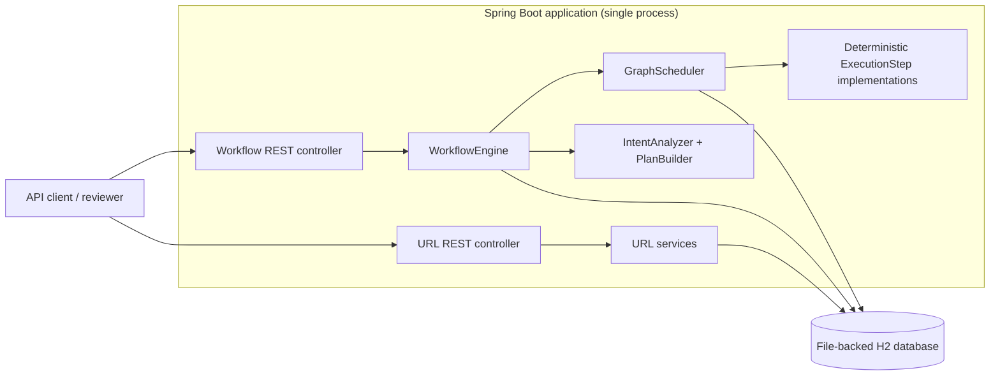
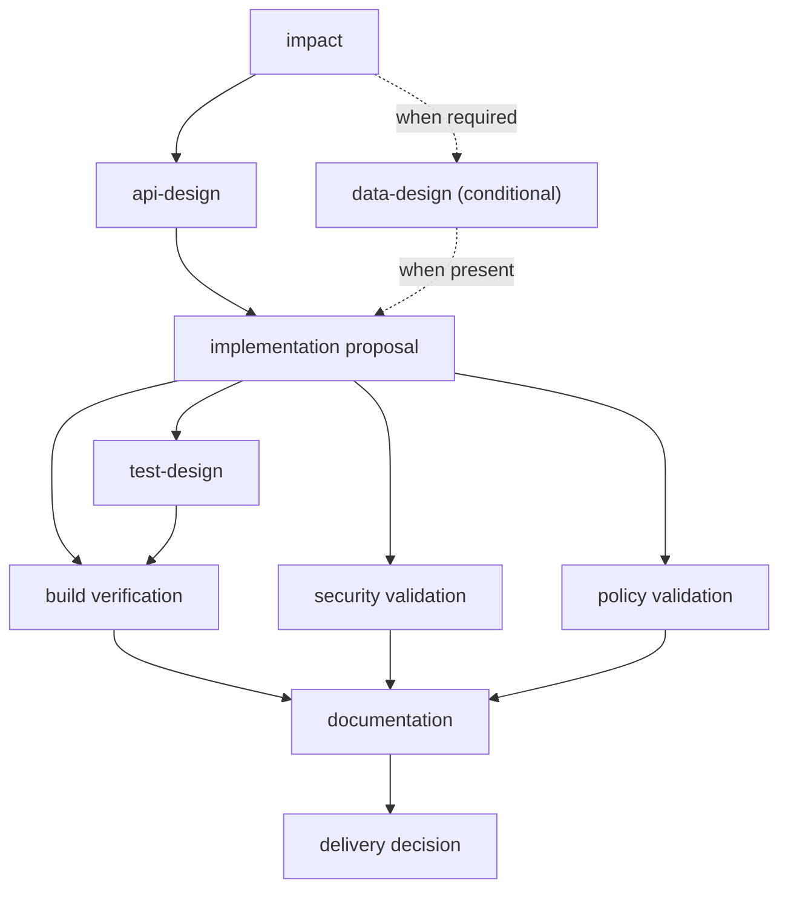
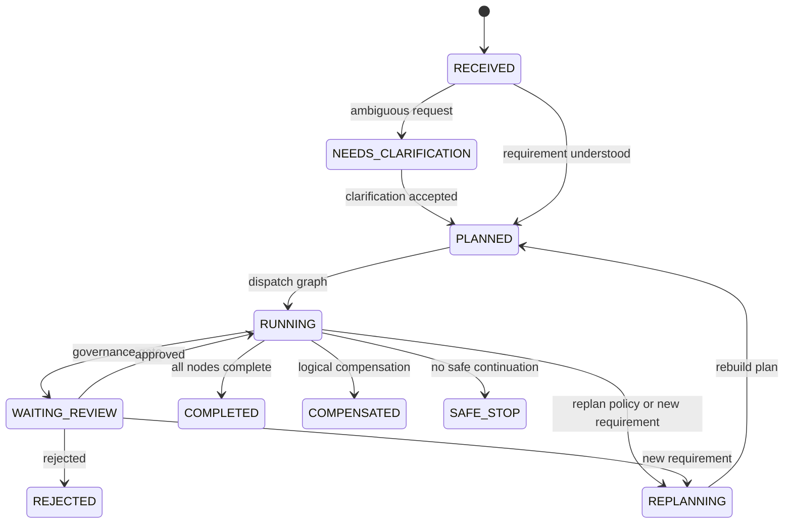

# Architecture Overview

> **Scope:** Current implementation of the URL Shortener Orchestrator prototype. This document describes what the code does today, not a future production deployment. See [risks and limitations](risks-and-limitations.md).

## 1. System context and boundaries

The application is a **Java 17 / Spring Boot modular monolith** with two application domains:

- **`url`** handles short-link creation, optional expiration/custom aliases, HTTP redirects, and click-count analytics.
- **`agent`** handles deterministic engineering-workflow planning, execution, approval, state persistence, and audit evidence.

The domains share a single Spring Boot process and **Spring Data JPA / file-backed H2** persistence. Neither domain is independently deployed. No message broker, cloud worker, LLM, or real CI/security-scanner integration is used by the current workflow implementation.

The orchestration module **models** engineering work; it does not autonomously implement a source-code change or deploy a release.

## 2. Component responsibilities

| Component | Current responsibility | Key source |
| --- | --- | --- |
| `UrlController` / URL services | Create/resolve links and retrieve analytics | `url/controller`, `url/service` |
| `WorkflowController` | Start, clarify, review, replan, and inspect a workflow | `agent/controller/WorkflowController.java` |
| `WorkflowEngine` | Manage workflow lifecycle and plan versions; persist events; dispatch scheduler | `agent/execution/WorkflowEngine.java` |
| `IntentAnalyzer` | Keyword-based risk and ambiguity classification | `agent/execution/IntentAnalyzer.java` |
| `PlanBuilder` | Build a risk-aware dependency graph and step policies | `agent/execution/PlanBuilder.java` |
| `GovernancePolicy` | Choose approval mode for API/data design and delivery | `agent/governance/GovernancePolicy.java` |
| `GraphScheduler` | Select ready nodes, run independent nodes locally, persist results, pause for review | `agent/execution/GraphScheduler.java` |
| `ExecutionStep` implementations | Return **deterministic, simulated** engineering evidence | `agent/execution/*Step.java` |
| JPA repositories | Store workflow, step, approval, event, and shortened URL records | `agent/repository`, `url/repository` |

**Execution model:** The HTTP request enters `WorkflowEngine`; it synchronously calls `GraphScheduler`. Within each ready wave, steps run concurrently using `CompletableFuture.supplyAsync` and the default executor. This is **local concurrency**, not durable or distributed task execution.

## 3. Versioned execution graph

`PlanBuilder` creates the following graph for a request that implies expiration or schema work. The `data-design` node is omitted for other requests.

Each persisted node has `ExecutionMode`, `FailureStrategy`, and `maxRetries`. A node is eligible to execute only when its declared dependencies have `SUCCEEDED`. Nodes that become eligible in the same wave may run concurrently; the scheduler waits for that wave before proceeding.

For a complete, annotated request/approval flow, see [workflow diagrams](diagrams/workflow-execution.md).

## 4. Workflow lifecycle and governance

`IntentAnalyzer` checks the request for predefined keywords to determine risk or require clarification. This is a deterministic heuristic, **not** an LLM inference step.

- Ambiguity produces `NEEDS_CLARIFICATION` before plan creation.
- `GovernancePolicy` requires review **before** API design for medium/high risk and **before** data design when present.
- High-risk delivery requires review **after** the delivery step; approval resumes without rerunning that completed step.
- Approval records are scoped to workflow ID, plan version, step ID, and phase; a unique database constraint guards that tuple.

*The diagram shows representative transitions; transitions are performed by synchronous engine methods, not by a standalone state-machine framework.*

## 5. Persistence and auditability

| Entity | Persisted data |
| --- | --- |
| `WorkflowEntity` | Requested/normalized requirement, clarification, risk, status, current plan version, automatic replan count |
| `ExecutionStepEntity` | Node type/dependencies/policy, plan version, attempts, status, output JSON, timestamps, superseded flag |
| `ApprovalEntity` | Step review decision and phase scoped to a specific plan version |
| `ExecutionEventEntity` | Audit events emitted during intake, planning, execution, review, replanning, and termination |
| `ShortUrlEntity` | Short code, target URL, creation/expiration timestamps, click count |

Before resuming an approved workflow, the engine reads successful step JSON and **rehydrates** the in-memory execution context. Replanning marks prior steps `superseded`, increments the plan version, and retains earlier audit data.

**Important distinction:** Persistence of *records* is implemented; automatic crash recovery for `RUNNING` operations is **not**. A database row alone cannot prove whether an in-flight external side effect completed.

## 6. Recovery model

| Mechanism | Implemented behavior | Deliberate limitation |
| --- | --- | --- |
| Retry | `maxRetries` bounds repeated execution of a failing step | Local, synchronous retry; no durable backoff/retry queue |
| Fallback | Some simulated validation failures return a `fallbackUsed` result | Not an external security-scanner failover |
| Replan | Supersede prior plan, increment version, generate new graph | Automatic replans are limited to one |
| Logical compensation | Discard the proposed engineering change and mark workflow `COMPENSATED` | Not an infrastructure rollback or Git revert |
| Safe stop | Persist `SAFE_STOP` when the policy cannot continue | No automatic operator remediation |
| Human review | Persist decisions and resume from waiting state | Concurrent review requests need stronger transaction/locking behavior |

See [ADR-0004](adr/0004-governed-step-execution.md) for the scheduling trade-offs.

## 7. APIs, observability, and tests

- **Short links:** `POST /api/urls`, `GET /{code}`, `GET /api/urls/{code}/analytics`.
- **Workflows:** `POST /api/workflows`, `POST /api/workflows/{id}/clarification`, `POST /api/workflows/{id}/steps/{stepId}/review`, `POST /api/workflows/{id}/replan`.
- **Inspection:** `GET /api/workflows/{id}`, `/steps`, `/events`, `/approvals`, and `/metrics`.
- **Contracts:** `/v3/api-docs`; Swagger UI at `/swagger-ui/index.html`.
- **Runtime:** Spring Boot Actuator health, info, and metrics.
- **Fault injection:** `POST /api/demo/workflows` only with Spring profile `demo`.

The test suite covers URL APIs, graph planning, workflow approvals, scenario execution, OpenAPI, and architecture conventions. It does **not** yet validate production-scale concurrency, multi-process recovery, or deployed security controls. See [testing approach](testing.md).

## 8. Architecture decision records

- [ADR-0001: Modular monolith with domain boundaries](adr/0001-modular-monolith.md)
- [ADR-0002: Persist versioned workflow state and evidence](adr/0002-persist-versioned-workflow-state.md)
- [ADR-0003: Deterministic planning with risk-based human review](adr/0003-risk-based-human-review.md)
- [ADR-0004: Policy-driven local DAG execution and recovery](adr/0004-governed-step-execution.md)
- [ADR-0005: H2 and deterministic execution for the prototype](adr/0005-prototype-runtime-and-persistence.md)

## 9. Follow-up work (not implemented by this documentation commit)

1. Make code allocation and click analytics safe under concurrent requests.
2. Add transactional, concurrency-safe workflow approval and state transitions.
3. Use a bounded executor and explicit timeout/error handling.
4. Define restart recovery with step leases, idempotency, and checkpoints.
5. Harden deployment configuration; add PostgreSQL, migration scripts, and CI/CD.

These are tracked as **future changes**, not claims of existing behavior.
