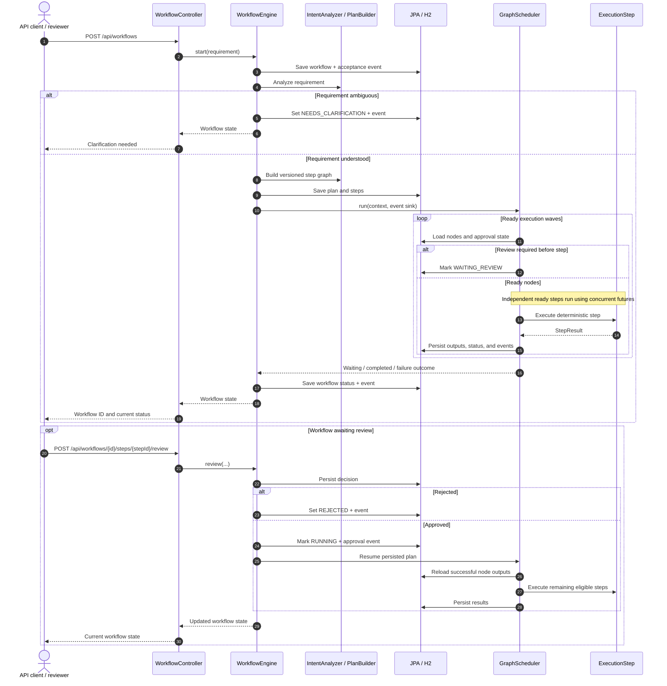
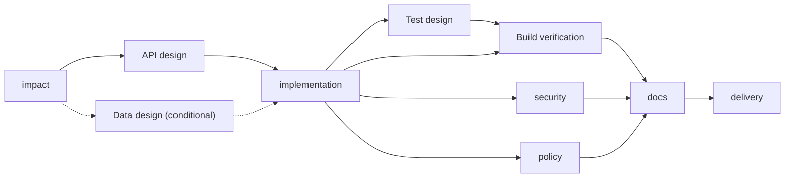

# Workflow Execution Diagrams

Diagrams reflect the current deterministic prototype. They illustrate call sequence, persisted state, and dependency ordering; they do **not** imply asynchronous infrastructure or real code generation.

## Request through approval

**What is persisted?** Workflow status, plan version, node dependencies and policies, attempt counts, results, events, and approval decisions.

**What is transient?** The request thread, local `CompletableFuture` tasks, and the concurrent in-memory shared-state map reconstructed for each run.

## Dependency ordering

The graph below shows the conditional `data-design` path for expiration/schema requirements. `build`, `security`, and `policy` are independently executable after their dependencies have succeeded.

## Boundary and recovery notes

- Review-before-execution means the node waits before its deterministic operation.
- Review-after-execution means the result is already persisted before human approval.
- Restarting the application does **not** automatically reclaim a node left `RUNNING`.
- A `REPLAN` outcome supersedes an earlier graph, preserves prior evidence, and constructs a new plan version.
- A `COMPENSATED` outcome is a logical discard of a proposed change, not a rollback of infrastructure or Git history.

[Back to architecture overview](../architecture.md).
